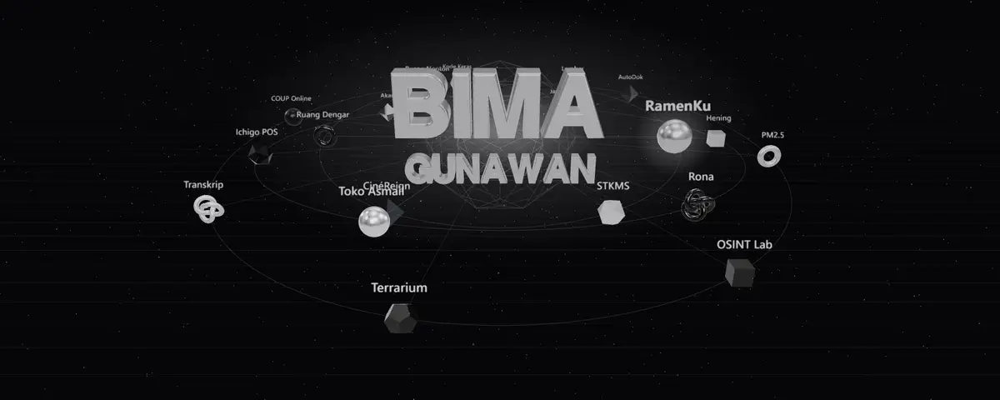
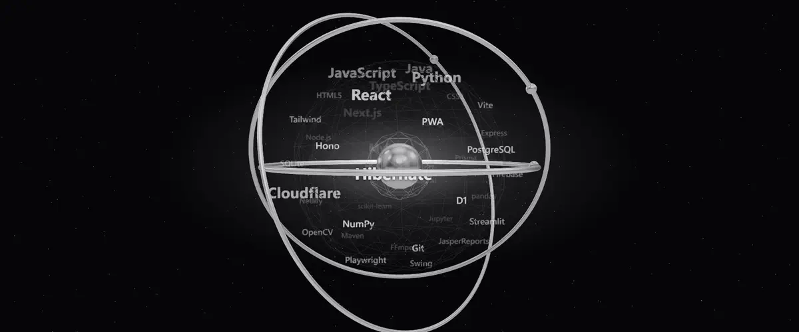

<a href="video/hero-2k-120fps.mp4"><b>▶ Tonton versi 2K · 120 fps</b></a>

 

## 👋 Tentang saya

Mahasiswa Informatika di Universitas Gunadarma. Saya membangun aplikasi web, game, dan alat kecil, dari ide sampai benar-benar dipakai.

## 🚀 Sedang saya kerjakan

<table>
<tr>
<td width="25%" align="center">🍜 <b>RamenKu</b> Aplikasi kedai ramen untuk praktikum RPL 2: Java Swing, MySQL, Hibernate</td>
<td width="25%" align="center">📄 <b>Dokumen otomatis</b> Proyek kelompok pembuat dokumen bisnis lewat satu formulir</td>
<td width="25%" align="center">📹 <b>Kanal Ngeriset</b> Video animasi singkat tentang hal-hal yang bikin penasaran</td>
<td width="25%" align="center">🔐 <b>Keamanan web</b> Belajar menemukan celah aplikasi web secara bertanggung jawab</td>
</tr>
</table>

## 🍜 Perjalanan RamenKu

Satu aplikasi yang tumbuh setiap pekan di praktikum Rekayasa Perangkat Lunak 2.

| Pekan | Tahap | Status |
|:--:|---|:--:|
| 1 | Rancangan aplikasi kedai ramen | ✅ |
| 2 | OOP: Encapsulation, Inheritance, Polymorphism | ✅ |
| 3 | Login, tiga fitur, JDBC ke MySQL, laporan PDF | ✅ |
| 4 | Hibernate: entitas, HQL, dan transaksi | ✅ |
| 5 sampai 7 | Menyusul | ⏳ |
| 8 | Ujian praktikum | 🎯 |

👉 [Lihat repositorinya](https://github.com/bimagwn/BimaGunawan)

## ✨ Sorotan proyek

<table>
<tr>
<td width="33%" valign="top">🎓 <b>STKMS</b> Dasbor premium mahasiswa Gunadarma: jadwal, kehadiran, verifikasi KTM <code>Supabase · Cloudflare</code></td><td width="33%" valign="top">🎬 <b>CinéReign</b> Platform streaming film bergaya sinematik <code>Next.js · Prisma · FFmpeg</code></td><td width="33%" valign="top">🎧 <b>Ruang Dengar</b> Perpustakaan dengar: channel, video, dan musik tersinkron <code>Cloudflare D1 · PWA</code></td>
</tr>
<tr>
<td width="33%" valign="top">📺 <b>Ruang Nonton</b> Nonton bareng dengan pemutaran tersinkron <code>Durable Objects</code></td><td width="33%" valign="top">🐸 <b>Terrarium</b> Paludarium 3D interaktif dengan desa dan makhluk hidup <code>Three.js · Vite</code></td><td width="33%" valign="top">📝 <b>Lembar</b> Penyusun laporan praktikum langsung menjadi Word <code>JavaScript · Pages</code></td>
</tr>
</table>

<b>📚 Lihat semua proyek</b>

 

### 🌐 Terbuka di GitHub

| Proyek | Isi |
|---|---|
| [**BimaGunawan**](https://github.com/bimagwn/BimaGunawan) | RamenKu: kode, materi, tugas, dan laporan praktikum RPL 2 per pertemuan |

### 🔒 Repo privat

Repo-nya privat, tetapi ini yang pernah saya bangun.

| Proyek | Isi | Teknologi |
|---|---|---|
| 📄 **AutoDok** | Automasi dokumen SPK, Kwitansi, dan BAST dengan ekspor PDF dan Word | Java Swing, MySQL |
| 🏢 **Dokumen Otomatis CV Andalan** | Aplikasi pembuat dokumen bisnis otomatis (proyek kelompok P3L) | JavaScript, Cloudflare D1, MySQL |
| 🌫️ **Prakiraan Udara Jabodetabek** | Sistem prediksi PM2.5 wilayah Jabodetabek | Python, Random Forest, Streamlit |
| 🎓 **STKMS** | Dasbor premium untuk mahasiswa Gunadarma: jadwal, kehadiran, dan verifikasi KTM | JavaScript, Supabase, Cloudflare Pages |
| 🎬 **CinéReign** | Platform streaming film bergaya sinematik | Next.js, Prisma, PostgreSQL, FFmpeg (HLS) |
| 🎧 **Ruang Dengar** | Pemutar channel, video, dan musik dengan progres tersinkron | JavaScript, Cloudflare D1 |
| 📺 **Ruang Nonton** | Nonton bareng dengan pemutaran tersinkron | Cloudflare Workers, Durable Objects |
| ▶️ **Video Stream PWA** | Aplikasi streaming video pribadi | Next.js, Supabase, Cloudflare Pages |
| 🏪 **Toko Asmail** | Manajemen toko kelontong | React, Vite, Express, SQLite |
| 🍜 **Ichigo Ramen POS** | Aplikasi kasir untuk usaha ramen | JavaScript (PWA) |
| 📝 **Lembar** | Penyusun laporan akhir praktikum langsung menjadi Word | JavaScript, Cloudflare Pages |
| 📊 **Rona** | Pengolah laporan harian dan mingguan menjadi format rapi | JavaScript, Cloudflare Workers, KV, D1 |
| 🌱 **Akar** | Pelacak perjalanan pengembangan diri selama tiga tahun | JavaScript (PWA), Cloudflare D1 |
| 📅 **Janji Temu** | Agenda kuliah dan janji dengan pengingat | JavaScript (PWA), Cloudflare D1 |
| 🧘 **Hening** | Ruang fokus dengan timer, suara latar, dan napas terpandu | JavaScript, Web Audio |
| 🐸 **Terrarium** | Paludarium 3D interaktif dengan desa dan makhluk hidup | Three.js, Vite |
| 🎙️ **Transkrip** | Mengubah rekaman panjang menjadi teks | Cloudflare Workers AI (Whisper) |
| 🃏 **COUP Online** | Game Coup multiplayer 2 sampai 10 pemain dengan chat | JavaScript, Firebase |
| 🎮 **Kode Keras** | Game visual novel dua pemain | JavaScript, Cloudflare Pages |
| 📹 **Ngeriset** | Kanal YouTube animasi penasaran, dibuat dengan alur otomatis | Python, FFmpeg |

## 🛠️ Teknologi

<b>🔎 Lihat per kategori</b>

 

**Bahasa** 
     

**Web dan antarmuka** 
     

**Backend dan database** 
         

**Cloud dan deploy** 
    

**Data dan AI** 
     

**Alat** 
    

